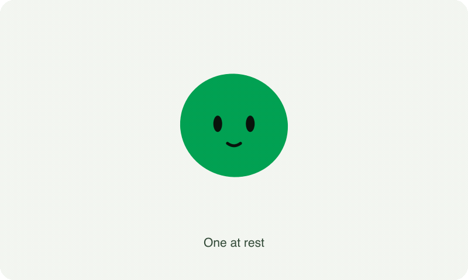

# Skills by Matt Blair

Skills for the things I build. Each folder contains a `SKILL.md` your coding agent can read.

## avatar-me

You've probably seen apps with those fun little avatars for each user. [avatar-me](avatar-me) helps you make your own, using the logo and colours already in your codebase.



The skill grew out of building Ormitar for [Fóir](https://foir.io), with [Blobatar by Alain00](https://github.com/Alain00/blobatar) as the original inspiration. It guides the agent through finding a character, choosing a signature gesture, and building an independent component in your project.

[See the design process and installation instructions](avatar-me/README.md), or [read about it on mattblr.com](https://mattblr.com/skills/avatar-me).

## turtleneck


[turtleneck](turtleneck) gives your coding agent a process for work on a big project, from the first analysis through to production. The agent writes an RFC before any ticket is filed. For each change it drives the real app as a smoke test, then hands you a short list of what to check yourself.

It comes from work on large enterprise software projects. Your project's commands go in a `turtleneck.md` profile, which the skill writes on its first run.

[See the steps and installation instructions](turtleneck/README.md).

## rust

[rust](rust) gives your coding agent house rules for writing, testing and reviewing Rust. It covers the judgement calls the compiler and clippy can't check, such as whether an error is the right kind, whether output is deterministic and whether a test could ever fail. It builds on Microsoft's Pragmatic Rust Guidelines, linking each one so the agent reads only those that apply.

[See what it covers and installation instructions](rust/README.md).

## Install a skill

Clone this repository and copy the folder for the skill you want into your agent's skills directory. For Codex:

```sh
git clone https://github.com/mattblr/skills.git
mkdir -p ~/.codex/skills
cp -R skills/avatar-me ~/.codex/skills/avatar-me
```

For Claude Code, install it for your user:

```sh
mkdir -p ~/.claude/skills
cp -R skills/avatar-me ~/.claude/skills/avatar-me
```

Or copy `avatar-me` into `.claude/skills/avatar-me` inside a project to share it with that project's contributors. In Claude Code, invoke it with `/avatar-me`, followed by what you want to build. For example:

> /avatar-me Make a character from our logo, with a few variations for user profiles. Show me the resting pose and a signature animation first.


Skill instructions are MIT licensed. The Fóir and Ormitar artwork illustrates the case study and remains brand material; see [LICENSE](LICENSE).

## App delivery skills

- [mobile-app-verification](mobile-app-verification/SKILL.md): Build and walk through a native Apple app with MobileBuildMCP, including adaptive and foldable layouts. Use for runtime verification and release evidence, not static code review alone.
- [app-store-release](app-store-release/SKILL.md): Review an Apple app and prepare its App Store submission, metadata and verification evidence. Use for store readiness or submission work; submission itself requires user authorization.
- [foir-billing](foir-billing/SKILL.md): Set up or verify Stripe web and RevenueCat native billing for a Fóir-backed app, with shared identity and server-enforced entitlements. Use for provider setup, purchase reconciliation and billing release checks.
- [foir-go-live](foir-go-live/SKILL.md): Prepare and verify a Fóir app's dev-to-production cutover, including published-only hosting, drafts preview, identity, operations and rollback. Use for environment promotion and go-live checklists.

Install these like the existing skills, replacing `foir-go-live` below with the
folder you want. Codex:

```sh
mkdir -p ~/.codex/skills
cp -R skills/foir-go-live ~/.codex/skills/foir-go-live
```

Invoke `$foir-go-live Prepare our production cutover and rollback checks`.
Use `$mobile-app-verification Walk through our app on phone and Duo`,
`$app-store-release Prepare our next submission`, or
`$foir-billing Verify our shared web/native subscription grants` as appropriate.

Claude Code:

```sh
mkdir -p ~/.claude/skills
cp -R skills/foir-go-live ~/.claude/skills/foir-go-live
```

Invoke `/foir-go-live Prepare our production cutover and rollback checks`.
The other entry points are `/mobile-app-verification`, `/app-store-release`,
and `/foir-billing` with the same task descriptions above. Project-specific
hosts, commands and authorization belong in the project's `turtleneck.md`.

## Fóir app planning and building

- [plan-foir-app](plan-foir-app/SKILL.md) maps a product-discovery brief onto the
  current template, identifies what stays/changes and creates workstream tickets.
- [build-foir-app](build-foir-app/SKILL.md) implements those tickets using Fóir's
  native features while preserving iOS, web, subscriptions and embedded admin.

Use the template's discovery skill first to establish the idea, users, journeys
and commercial model. These skills consume that brief rather than guessing it.
Install both for Codex from a clone of this repository:

```sh
cp -R skills/plan-foir-app skills/build-foir-app ~/.codex/skills/
```

For Claude Code:

```sh
cp -R skills/plan-foir-app skills/build-foir-app ~/.claude/skills/
```

Invoke `$plan-foir-app` then `$build-foir-app` in Codex, or `/plan-foir-app` then
`/build-foir-app` in Claude Code, with the brief or planned ticket references.
